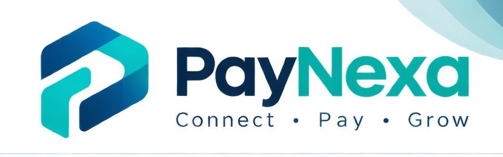

# Techyamacraw — Company & Product Identity

## 1. Techyamacraw

**Techyamacraw** is the company behind the development of digital products and technology solutions.

Official website: [https://techyamacraw.co.ke](https://techyamacraw.co.ke)

The website currently serves as the company's portfolio, showcasing its identity, work, and services.

Techyamacraw is the company. Its products and platforms operate under its brand.

## 2. Introducing PayNexa

**PayNexa** is a planned payment gateway and transaction management platform developed by Techyamacraw.

Its purpose is to provide organizations with a centralized platform through which they can initiate payments, manage merchant applications, process payment callbacks, monitor transactions, and receive payment notifications.

PayNexa is designed as a multi-tenant platform: multiple organizations will use the same platform while keeping their users, configurations, merchant clients, and transaction data appropriately separated.

## 3. Relationship Between Techyamacraw and PayNexa

The relationship is:

- **Techyamacraw:** The company that develops and operates the product.
- **PayNexa:** The payment platform developed by Techyamacraw.
- **Organizations:** Businesses or institutions that register on PayNexa to use its payment services.
- **Merchant applications:** Websites or applications belonging to registered organizations that integrate with PayNexa.

Techyamacraw will also use PayNexa as one of its registered organizations.

## 4. Product Development and Rollout

The planned rollout is:

1. Develop PayNexa as an independent application with its own database and architecture.
2. Complete and test the core payment gateway.
3. Integrate the dependencies currently required by the Techyamacraw website.
4. Register Techyamacraw as an organization on PayNexa.
5. Connect the Techyamacraw website through its merchant API credentials.
6. Test the integration in a controlled environment before production use.
7. Begin onboarding other organizations.
8. Gradually expand the platform's capabilities and supported payment providers.

The initial payment integration will use **Safaricom M-Pesa Daraja**.

The long-term direction is to make PayNexa a broader payment infrastructure platform rather than permanently limiting it to one payment provider.

## 5. Product Identity

**Product name:** PayNexa

**Developed by:** Techyamacraw

**Product category:** Payment Gateway & Transaction Management Platform

**Initial integration:** Safaricom M-Pesa Daraja

**Architecture:** Multi-tenant

**Initial market direction:** Kenya, with potential to expand into other markets.

## 6. Branding

The PayNexa logo included with this document is provisional.

It is intended to establish an initial visual identity using a modern fintech-inspired design. The logo, colors, typography, and tagline may be modified as the product identity develops.

Provisional logo:

## 7. Long-Term Direction

Techyamacraw aims to develop PayNexa into an independent product capable of serving organizations beyond its original company website.

The platform should be designed to grow in supported payment methods, integrations, transaction management capabilities, and organizational scale.

**Techyamacraw builds. PayNexa powers payments.**
